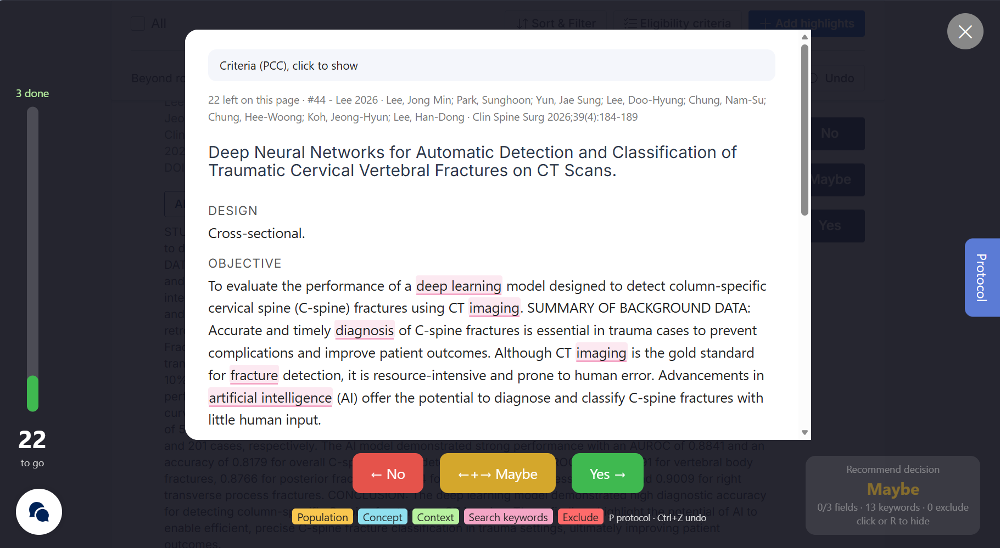

# Screening papers is fun, just like Tinder (or Anki, if you like)

▶️ [Watch the 2-minute tutorial](docs/tutorial.mp4) · 🎬 [Watch the 1-minute demonstration](docs/demo.mp4)

A Chrome extension for title and abstract screening in [Covidence](https://www.covidence.org/).
Swipe right to include, swipe left to exclude, and see your protocol keywords highlighted as you read.

> **This tool only helps you read.**
> It does not screen for you.
> Every Yes, No and Maybe is your own decision, cast through Covidence's own buttons.
> The "recommended decision" is a simple keyword count, not an AI model, and it can be wrong.

## Why

Title and abstract screening means reading hundreds of abstracts against the same criteria.
This extension makes each abstract easier to scan.

- **One paper at a time** on a clean card, with the criteria one click away.
- **Your protocol words highlighted** in a colour per framework field (for example Population, Concept and Context).
- **Abstracts split into Intro, Methods, Results and Discussion**, so you can jump to the part that decides eligibility.
- **Fast decisions** with a swipe, a key or a touchpad gesture.

## Install

The extension is not on the Chrome Web Store yet, so you load it in developer mode.

1. Click **Code → Download ZIP** on this page and unzip it, or `git clone` the repository.
2. Open `chrome://extensions` in Chrome (Edge works too, at `edge://extensions`).
3. Switch on **Developer mode** (top right).
4. Click **Load unpacked** and choose the unzipped folder, the one that contains `manifest.json`.
5. To update later, replace the files and press 🔄 **reload** on the extension card.

## Use

1. Open your review in Covidence and go to **Title and abstract screening**.
2. Press **S** to open the swipe card.
3. The first time in each review, set up your protocol (see below).
4. Screen.

| Action | Keyboard | Touchpad | Touchscreen |
|---|---|---|---|
| **No** | ← | two-finger swipe left | swipe left |
| **Yes** | → | two-finger swipe right | swipe right |
| **Maybe** | ← and → together, or ↑ / ↓ | two-finger tap | swipe up or down |
| Write a note on this paper | N, then Enter | | |
| Undo last vote | Ctrl + Z | | |
| Edit protocol | P, or the **Protocol** tab on the right | | |
| Recommendation on / off | R, or click the box | | |
| Close | Esc, or ✕ top right | | |

- **Notes.** Press N and write why you chose Maybe (or anything else). Notes save automatically when you vote or press Enter, and show again if the paper comes back. The CSV lists each paper's Covidence ID, first author and year, title, DOI link, vote and note. Closing the card downloads it for you, the browser warns you if you leave Covidence with unexported notes, and the Protocol page has an export button too. Notes stay in your browser and are not sent to Covidence.
- Dragging with the mouse selects text and never casts a vote.
- The bar on the left shows how many papers you have screened and how many are left on this page. Click it to hide it.
- Ctrl + Z uses Covidence's own Undo button when one is shown. If Covidence offers none, it tells you which paper to change by hand.

## Set up your protocol

Each Covidence review keeps its own protocol, stored only in your browser.

1. **Choose the question framework.** The options match Covidence: PICOS, PECOS, SPIDER, PICo, PCC, SPICE or Other.
2. **Upload your protocol as a `.docx`**, or open it in Word, press Ctrl + A then Ctrl + C, and paste it into the box.
   The extension reads only what it needs and ignores background and methods text.
   - lines or table rows that start with a field name, such as `Population`, `Concept` or `Context`
   - `Inclusion` and `Exclusion` lists
   - Boolean search lines, such as `(deep learning OR machine learning) AND fracture`
3. **Click Extract keywords** and check the words it found.
   Long phrases are shortened to terms that appear in abstracts, for example `radiologist*`.
   Edit anything you like. Separate terms with commas, and use `*` for truncation.
4. **Save and start screening.**

| Colour | Meaning |
|---|---|
| Yellow, blue, green, purple, orange | framework fields, in order |
| Pink | search string and inclusion keywords |
| Red | exclusion words |

## The recommended decision

The box in the bottom right suggests Yes, Maybe or No.
Hover over it to see how it was reached and which words matched.

- **No** if an exclusion word is in the title, or there are two or more exclusion words and not every field matched.
- **Yes** if every framework field matched and at least one search keyword appears.
- **Maybe** if at least one field matched or two search keywords appear.
- Otherwise **No**.

It cannot understand meaning, so treat it as a hint, never as the decision.

## Privacy

- Nothing leaves your browser. There is no server and no tracking.
- Your protocol is saved with `chrome.storage.local`, one entry per Covidence review.
- The extension runs only on `app.covidence.org`.

## Limitations

- Not affiliated with or endorsed by Covidence.
- It reads the Covidence page layout, which may change. If the card shows no studies, please open an issue.
- Section headings are guessed from wording when the abstract has no labels, and the card says so.

## Licence

MIT
